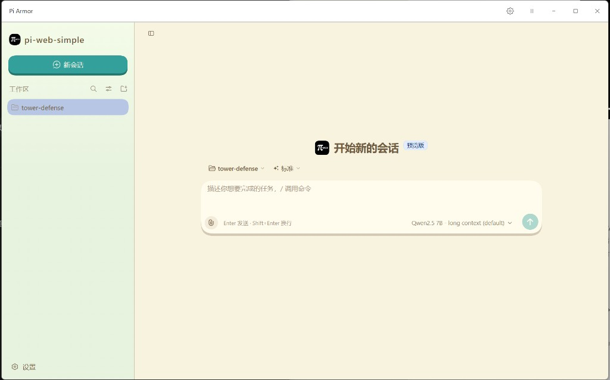
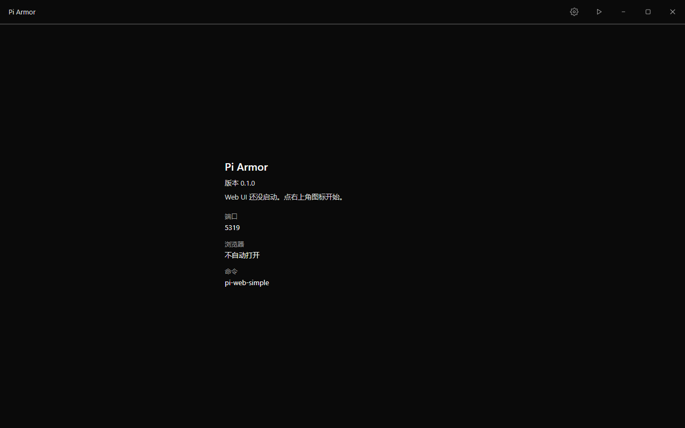
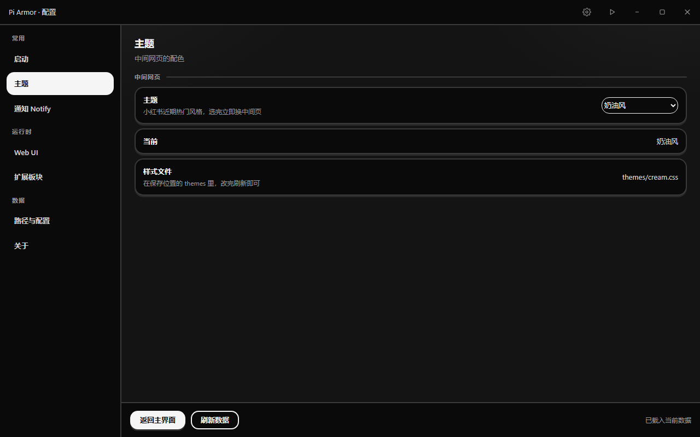
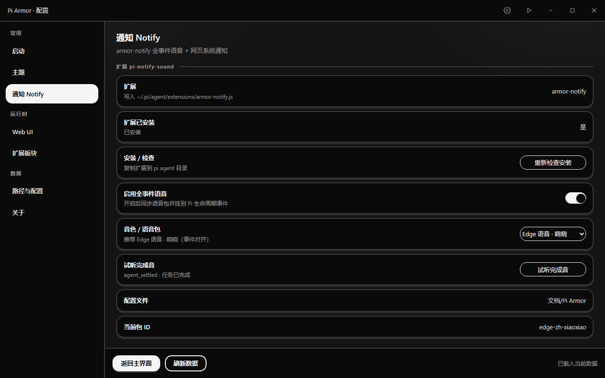

# Pi Armor

给 [Pi](https://github.com/badlogic/pi-mono) 的网页界面套一个本机窗口。打开就能用，不用再单独找浏览器；也可以换中间页的配色，并用语音听会话进度。



还没拉起网页时，窗口中间会先显示名称、版本和启动参数。



## 能做什么

- 打开窗口即拉起官方 `pi-web-simple`，页面地址是 http://127.0.0.1:5319 。
- 窗口没有系统边框。按住左侧标题拖动。右侧依次是配置、启动、最小化、最大化、关闭。播放图标是启动，暂停图标是已经在跑。
- 本机本来就开着的网页只会接进来。点「停止」不会关掉它。只有这个窗口自己拉起的进程，退出或点「停止」时才会结束。
- 顶栏颜色跟随 Pi 的明亮或黑暗模式。
- 八套中间页主题：原来的样子、奶油风、粉彩风、云上舞白、多巴胺、新中式、美拉德、动物森友会。选完立即换。
- 通知页打开「启用全事件语音」后，会安装 `armor-notify`，并在新会话里按生命周期播报，例如开始、完成、调用工具、需要确认。网页系统通知是另一条线，可能叠在一起响。





## 开始使用

本机需要 Node.js 22.19 或更高版本，并且命令行里能直接执行 `pi-web-simple`。

```
cd pi-armor
npm install
npm run tauri dev
```

## 换电脑

样式和音色放在文档目录的 `Pi Armor` 文件夹里（`themes`、`sounds`）。在「路径与配置」里可以打开、另选文件夹或恢复默认。把整个文件夹拷到新电脑的文档目录即可。

## 许可

本项目采用 MIT 许可证，全文见 `LICENSE`。

`edge-zh-xiaoxiao` 的语音文件不放进仓库。需要时按 `ops/edge-voice-pack.md` 在本机重新生成。
